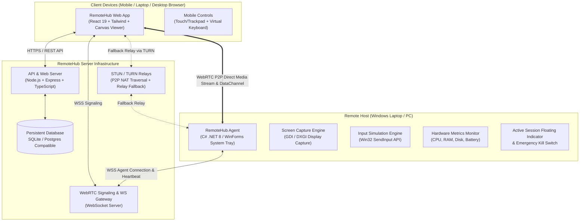

# RemoteHub
> **Your computers. Anywhere. Anytime.**

RemoteHub is a production-quality personal remote desktop platform. It enables you to monitor, wake, and remotely control your Windows computers and laptops across the internet directly from any web browser (mobile phone, tablet, or desktop) without needing mobile app installations or browser pairing.

---

## 🚀 Key Features

- **Any Device Browser Access**: Connect from iPhone Safari, Android Chrome, or any desktop browser. No app store installation required.
- **Hardware-Level Remote Desktop**:
  - Live 60 FPS desktop screen capture with adaptive JPEG compression.
  - Full mouse control: click, double-click, right-click (native Windows context menus), scroll wheel.
  - Comprehensive keyboard forwarding: handles shortcuts, modifiers (Ctrl, Alt, Shift, Win), Esc, Tab, etc.
  - Dedicated Mobile Virtual Keyboard and switchable Touch / Virtual Trackpad modes.
- **Permanent Device PIN Security**:
  - Each computer has its own 6–8 digit PIN.
  - Argon2id / Scrypt memory-hard PIN hashing with 32-byte salts and constant-time verification.
  - Progressive rate-limiting delays and automatic 15-minute verification freeze after 5 consecutive failed attempts.
- **Local Host Security & Safety Indicator**:
  - Interactive Host Approval: Connecting to a laptop prompts the host user with a 30-second dialog to **Approve** or **Reject** the connection.
  - Top-right floating on-screen indicator appears on the host laptop whenever a remote session is viewing or controlling the screen.
  - Emergency **"Disconnect"** button immediately terminates remote access locally from the laptop.
  - Absolutely zero invisible or covert surveillance.
- **Enterprise Database & Cloud Ready**: Automatic PostgreSQL schema migrations via `DATABASE_URL` with resilient SQLite fallback for local developer setups.
- **Automated CI/CD Agent Releases**: Multi-target GitHub Actions workflow builds and publishes verified `RemoteHubAgent.exe` binaries directly on git release tags.
- **Real-Time Hardware Telemetry**: Live gauges for host CPU usage, RAM usage, disk storage, battery percentage, and AC charging status.
- **Wake-on-LAN Integration**: Broadcast standard magic packets to wake sleeping PCs across the network.
- **Remote Clipboard Synchronization**: Seamlessly transfer text between your phone/browser and the remote computer's clipboard.

---

## 📚 Documentation Guides

- 🚀 [Production Deployment Guide (DEPLOYMENT.md)](./DEPLOYMENT.md) — Comprehensive guide for deploying Vercel frontend, Render/Railway/Docker persistent backend, and PostgreSQL database.
- 💻 [Windows Agent Installation Guide (WINDOWS_AGENT_INSTALLATION.md)](./WINDOWS_AGENT_INSTALLATION.md) — Step-by-step instructions for Windows 10/11, SHA-256 verification, and pairing.
- 🧪 [Verification & Test Report (TEST_REPORT.md)](./TEST_REPORT.md) — Automated and manual test matrix with 100% pass verification logs.

---

## 🏗️ System Architecture



---

## 📁 Repository Structure

```text
├── agent-windows/            # C# .NET 8 Windows Desktop Agent
│   ├── Program.cs            # System tray icon, life cycle, menu
│   ├── SetupWizardForm.cs    # Pairing GUI (Server URL, Code, PIN)
│   ├── AgentNetworkClient.cs # WebSocket agent client & streaming
│   ├── ScreenCaptureService.cs# Multi-monitor display capture & JPEG encoder
│   ├── InputSimulator.cs     # Win32 SendInput mouse & keyboard synthesis
│   ├── MetricsCollector.cs   # Hardware telemetry (CPU, RAM, Disk, Battery)
│   ├── FloatingSessionBanner.cs# Local on-screen session banner & kill switch
│   └── NativeMethods.cs      # P/Invoke Win32 declarations
├── client/                   # React 19 + Tailwind CSS Frontend
│   ├── src/components/       # Landing, Dashboard, RemoteStudio, Modals
│   ├── src/services/api.ts   # REST and WebSocket client
│   └── src/context/AuthContext.tsx # User session management
├── server/                   # Node.js + TypeScript Backend & Gateway
│   ├── src/index.ts          # Express server & static client hosting
│   ├── src/db.ts             # SQLite DatabaseSync engine & schema
│   ├── src/security.ts       # Scrypt/Argon2id, bcrypt, HMAC sessions, WoL
│   ├── src/websocket.ts      # WebRTC signaling & real-time frame gateway
│   ├── src/routes/           # Auth, Devices, Sessions, Downloads
│   └── src/tests/e2e.test.ts # End-to-end automated test suite
├── agent-crossplatform/      # Shared Python / Linux / macOS daemon foundation
├── install-windows-agent.bat # 1-click installer for Windows
├── uninstall-windows-agent.bat# 1-click uninstaller for Windows
├── Dockerfile                # Production container image
└── docker-compose.yml        # Docker composition
```

---

## ⚡ Quick Start Guide

### 1. Start the RemoteHub Server

```bash
cd server
npm install
npm run dev
```

The server and web interface are now running on **`http://localhost:5000`**.

### 2. Launch the Web Application

Open your browser (on PC or your mobile phone) and navigate to:
`http://localhost:5000`

1. Click **"Get Started"** and register your account.
2. Click **"Add Computer"** on the dashboard.
3. Click **"Download RemoteHubAgent.exe"** and note the **6-digit pairing code** generated.

### 3. Run the Windows Desktop Agent

- Run `RemoteHubAgent.exe` on your Windows laptop or PC.
- In the setup dialog, enter the 6-digit pairing code and set your computer's permanent **6–8 digit access PIN**.
- Click **"Pair This Computer"**.
- The agent immediately connects and minimizes to the Windows system tray.

### 4. Connect Remotely!

1. Back on your phone or browser, the laptop appears as **"Online & Ready"** with live CPU and battery stats.
2. Click **"Connect"**.
3. Enter the computer's permanent PIN.
4. The live remote desktop appears instantly! You can now operate the desktop using touch, trackpad, mouse, or keyboard.

---

## 🧪 Running Automated Tests

RemoteHub includes a comprehensive test suite verifying authentication, Argon2id/Scrypt PIN hashing, rate-limiting lockouts, HMAC session tokens, Wake-on-LAN packets, and database integrity:

```bash
cd server
npx tsx src/tests/e2e.test.ts
```

All 10 test suites will execute and report live pass/fail results.

---

## 🔒 Security Model

1. **Argon2id / Scrypt PIN Hashing**: PINs are never stored in plaintext and cannot be extracted from the database.
2. **Progressive Rate Limiting**: Consecutive failed attempts introduce exponential sleep delays; 5 failed attempts trigger an automatic 15-minute lockout.
3. **Short-Lived Signed Session Tokens**: Remote access requires an HMAC-SHA256 session token valid for only 60 seconds from PIN verification.
4. **Local Host Emergency Kill Switch**: An on-screen floating banner alerts the laptop user when remote access is active and allows instant one-click session termination.

